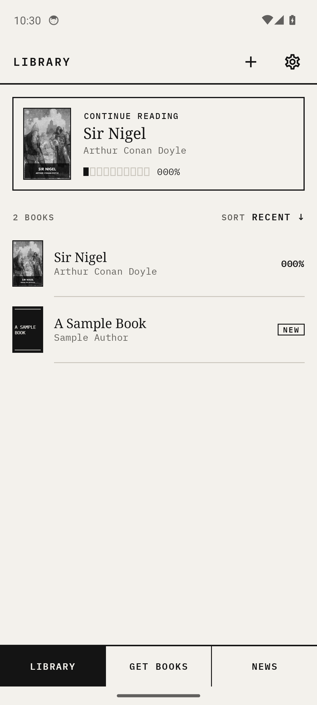
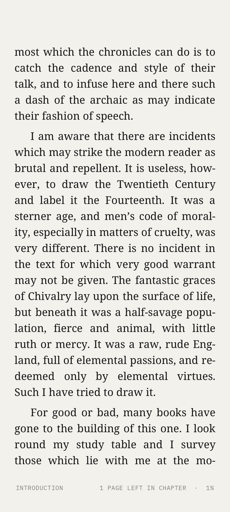
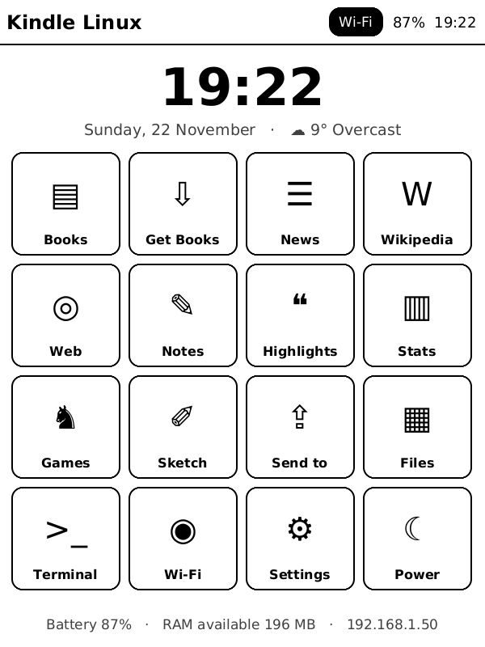
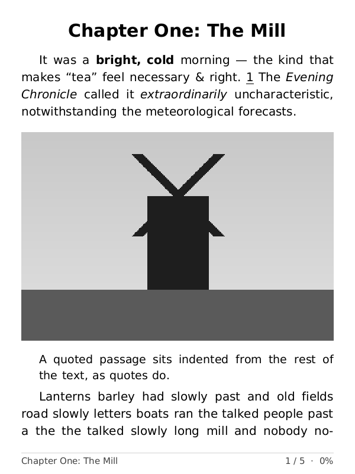

# Folio

**Folio** is a reading app for books and news, built around one shared Rust core. It runs on:

| Platform | What | Read more |
|---|---|---|
| **Android** | A native app (Kotlin, Jetpack Compose), package `io.folio.reader` | [platforms/android](platforms/android/README.md) |
| **E-ink Kindles** | **Folio OS**: a small Linux system with its own touch interface, for older jailbroken Kindles | [platforms/kindle](platforms/kindle/README.md) · [install guide](platforms/kindle/INSTALL.md) |

<p>




</p>

Both read EPUB, MOBI/AZW3, FB2, RTF, DOCX and TXT with the same engine, find free books across
Standard Ebooks, Project Gutenberg and your own OPDS catalogs (the Android app also Wikisource and,
optionally, Gutenberg Australia, Faded Page and the Internet Archive), and follow news feeds. The phone app
focuses on reading; Folio OS also turns the Kindle into a small independent Linux device (Wi-Fi, a
terminal, SSH, games).

This project used to be called **Kindle Linux**; see
[Upgrading from Kindle Linux](platforms/kindle/INSTALL.md#upgrading-from-kindle-linux).

## How it fits together

```
engine/        the shared core (Rust, no platform code): book formats, fonts and text shaping,
               hyphenation, page layout and drawing, reading sessions, news feeds, the Get Books
               sources (Gutenberg, Standard Ebooks, Wikisource, Gutenberg Australia, Faded Page,
               Internet Archive, OPDS) and how their results are mixed and ranked
bindings/      the engine's API for apps in other languages (UniFFI: Kotlin today, Swift next)
platforms/
  android/     the Android app (uses the engine through bindings/)
  kindle/      Folio OS (uses the engine directly)
data/          hyphenation patterns (built into the engine)
tests/         sample books and catalogs used by the tests and the Folio OS simulator
tools/         generators for those samples
```

The engine never touches the network, the screen or the file system layout: each platform fetches
with its own network stack, supplies its own fonts, and draws the pages the engine renders. That
keeps it portable to iOS, macOS and desktop Linux or Windows later.

## Building

```sh
cargo test                                    # the engine and Folio OS tests
cd platforms/android && ./gradlew assembleDebug   # the Android app (see its README)
platforms/kindle/build/build.sh               # Folio OS (Docker; see its README)
```

## Releases

Publishing a GitHub release (tag `vX.Y.Z`) runs [`.github/workflows/release.yml`](.github/workflows/release.yml):
it runs the tests, then attaches `Folio-X.Y.Z.apk` (signed) and `Folio-OS-X.Y.Z-kindle.zip` (unzip onto
the Kindle's USB drive) to the release. The APK is signed with the key stored in the repository secrets
`ANDROID_KEYSTORE_BASE64`, `ANDROID_KEYSTORE_PASSWORD`, `ANDROID_KEY_ALIAS` and `ANDROID_KEY_PASSWORD`.
To rebuild an existing release, run the workflow by hand with its tag.

## License

Folio is free software under the **GNU General Public License v3.0 or later**; see `LICENSE`.

Third-party components (Rust crates, fonts, Alpine packages in the Folio OS image) and data sources
(Open-Meteo weather under CC BY 4.0, Wikipedia text under CC BY-SA 4.0) are listed with their
licenses in [`THIRD_PARTY_LICENSES.md`](THIRD_PARTY_LICENSES.md).

Not affiliated with or endorsed by Amazon. "Kindle" is a trademark of Amazon.com, Inc. This project
does not remove DRM; Amazon store books remain readable only in the stock Kindle software.
