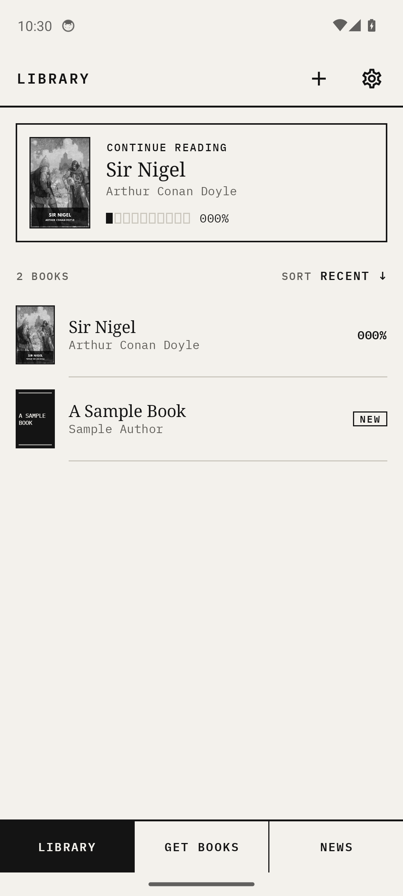
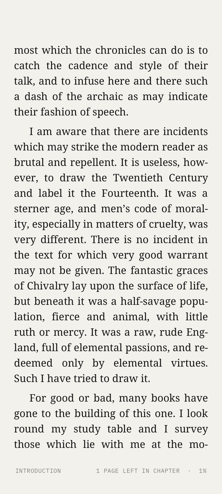
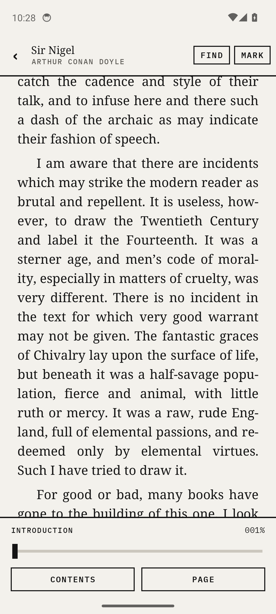
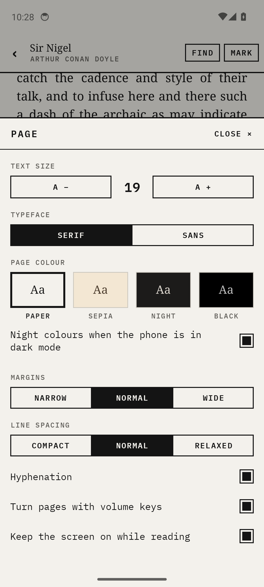
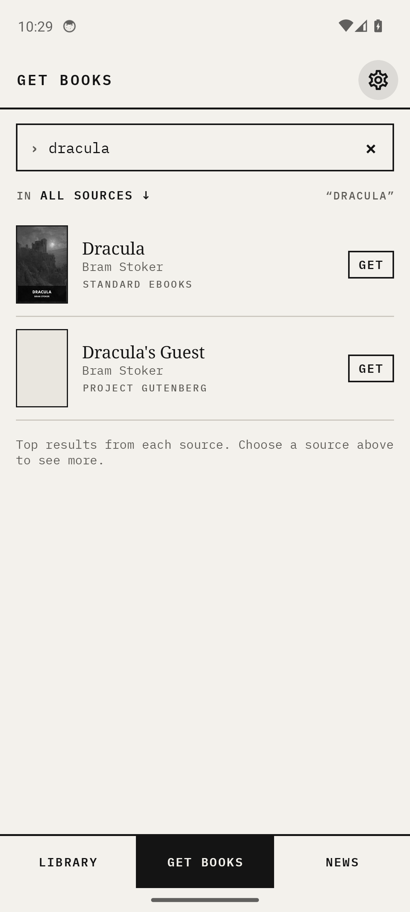
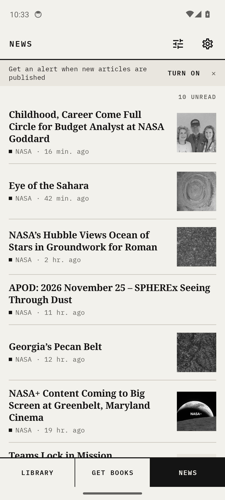
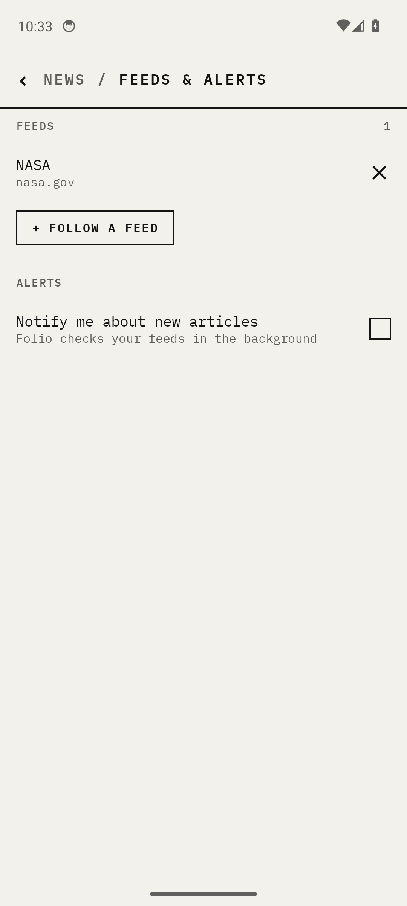
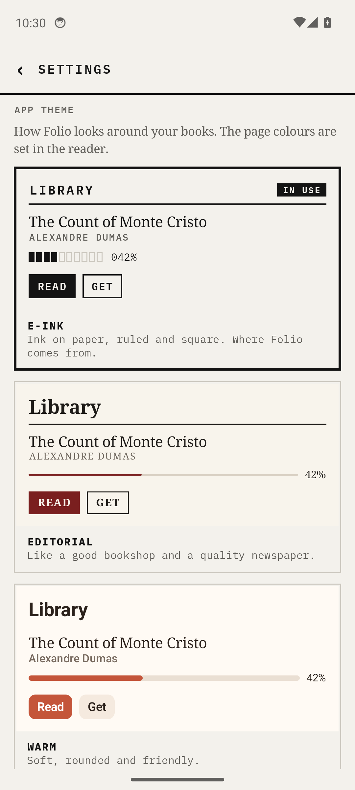
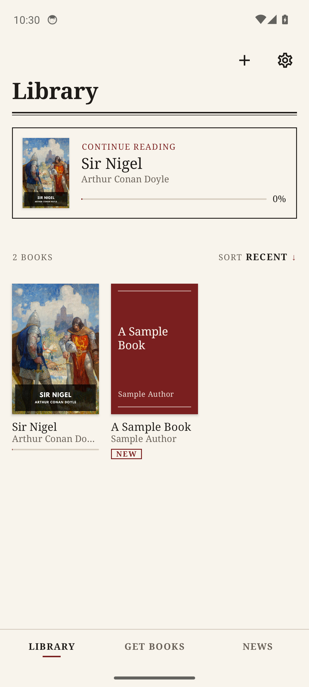
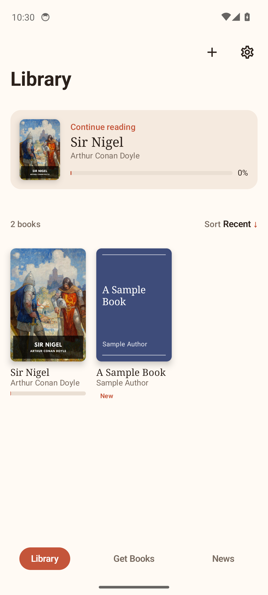

# Folio for Android

The Android app of [Folio](../../README.md): a reading app for books and news, built on the same
Rust engine as [Folio OS](../kindle/README.md) for e-ink Kindles. Pages are laid out and drawn by the
shared engine (hyphenation, justification, footnotes, Indic shaping); everything around them is
native Kotlin and Jetpack Compose.

Package `io.folio.reader` · Android 7.0 (API 24) and later.

## Screenshots

| | | |
|:-:|:-:|:-:|
| <br>Library | <br>Reader | <br>Reader controls |
| <br>Page settings | <br>Get Books | <br>Search (all sources) |
| <br>News | <br>Feeds & alerts | <br>App themes |
| <br>Editorial theme | <br>Warm theme | |

## Features

**Reading**
- EPUB, MOBI/AZW3 (DRM-free), FB2, RTF, DOCX, TXT and HTML, opened in Folio's own reader
- Tap the left or right of the page or swipe to turn; tap the middle for the controls; volume keys turn
  pages too. The first book shows where to tap
- Contents, bookmarks, search in the book, footnotes as pop-ups, a progress slider
- Text size, Serif or Sans, page colours (Paper, Sepia, Night, Black, Night automatically in dark mode),
  margins, line spacing, hyphenation
- Long-press a word to define, search, copy or share it
- The phone's own fonts cover other scripts (Hindi and other Indic scripts are shaped properly, CJK,
  Arabic, Hebrew…)

**Library**
- A shelf of your books with covers and progress, "Continue reading", sort by recent, title or author
- Add books from the phone, or "Open with Folio" / share from a browser download or a file manager

**Get Books**
- One search across Standard Ebooks, Project Gutenberg, Wikisource and your own OPDS catalogs (Calibre's
  content server and other library servers, with optional login), with the source as a filter. The
  closest matches come first; the same book from two sources is listed once (the better edition)
- **Wikisource** (on by default, in the phone's language when Wikisource has it, or any of 22 languages):
  volunteer-proofread texts, downloaded as EPUB through Wikisource's export service
- More sources, all on by default and each can be turned off in *Book sources* (Settings, or the source filter):
  **Project Gutenberg Australia** and **Faded Page** (Canada), which are public domain under those
  countries' shorter copyright terms, and the **Internet Archive** (EPUBs of books published before 1930
  or marked public domain). Australia's and Faded Page's whole lists are kept on the phone (refreshed
  weekly) and searched there
- A slow source is reported, not waited for: results show as each source answers
- Browsing shows the newest Standard Ebooks and the most popular Gutenberg books
- Downloads run in the background with progress, and go straight into the library

**News**
- Follow RSS and Atom feeds from a catalogue or any website (Folio finds its feed)
- Articles open in the reader; when a feed only has a teaser, the full article is fetched and
  cleaned up (reading view)
- Optional alerts for new articles, checked in the background: per-feed, how often, Wi-Fi only,
  one summary or one per article, silent at night

**Looks**
- Three app themes: **E-ink** (the default: ink on paper, ruled, monospaced labels), **Editorial**
  and **Warm**, each in light and dark. Themes can later be unlocked by supporting the project
  (the hook exists; no billing yet)

All network access (feeds, articles, books, covers) uses the phone's own network stack, so its proxy,
VPN, certificates and data settings apply. Plain `http://` is allowed for home library servers.

## Building

Needs JDK 17, the Android SDK (platform 35, build tools 35) and NDK (27.x), Rust with the Android
targets, and [`cargo-ndk`](https://github.com/bbqsrc/cargo-ndk):

```sh
rustup target add aarch64-linux-android x86_64-linux-android
cargo install cargo-ndk
cd platforms/android
./gradlew assembleDebug        # or assembleRelease
adb install -r app/build/outputs/apk/debug/app-debug.apk
```

Gradle runs [`build-engine.sh`](build-engine.sh) first: it builds the shared engine for Android
(`libengine_ffi.so` for arm64-v8a and x86_64) and generates its Kotlin API with UniFFI, into
`app/build/engine/`. Set `FOLIO_ABIS` to build fewer ABIs.

Release builds are signed with the key named in `keystore.properties` (`storeFile`, `storePassword`,
`keyAlias`, `keyPassword`) when that file exists. The key and `keystore.properties` are gitignored;
keep a backup of the key, since updates must be signed with the same one.

## What's in this folder

| Path | What |
|---|---|
| `app/src/main/java/io/folio/reader/` | The app: `MainActivity.kt` (navigation), `LibraryScreen.kt`, `ReaderScreen.kt` + `ReaderController.kt` (the engine on a background thread, pages as bitmaps), `GetBooks.kt` + `GetBooksScreen.kt` (sources, downloads), `Feeds.kt` + `NewsScreen.kt` (feeds, background checks, notifications), `SettingsScreen.kt`, `Ink.kt` (the design system and app themes), `Settings.kt` (reader settings, fonts), `Library.kt`, `Http.kt` |
| `app/src/main/res/font/` | IBM Plex Mono (interface type) |
| `app/src/main/assets/fonts/` | DejaVu (the Sans reading face; the shared engine bundles no fonts) |
| `app/src/main/assets/licenses/` | Font licenses |
| `screenshots/` | The screenshots above |
| `build-engine.sh` | Builds the engine and its Kotlin bindings (run by Gradle) |

The engine lives in [`engine/`](../../engine) and its bindings in [`bindings/`](../../bindings) at
the repository root, shared with Folio OS.

## License

GPL-3.0-or-later, like the rest of Folio; third-party components are listed in
[`THIRD_PARTY_LICENSES.md`](../../THIRD_PARTY_LICENSES.md).
